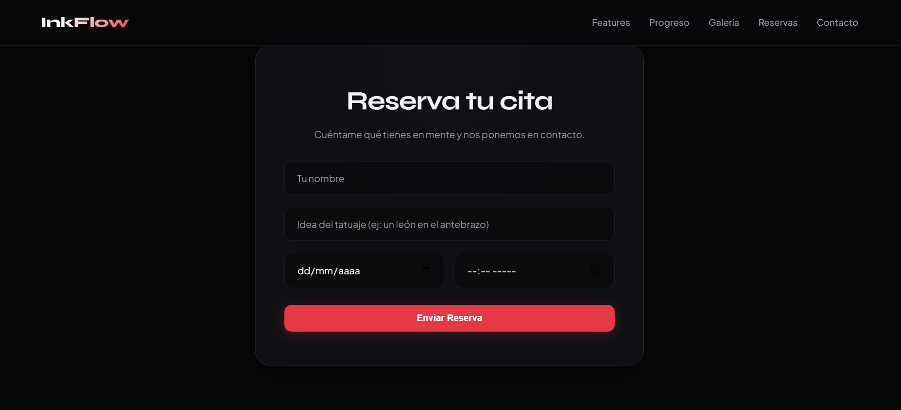
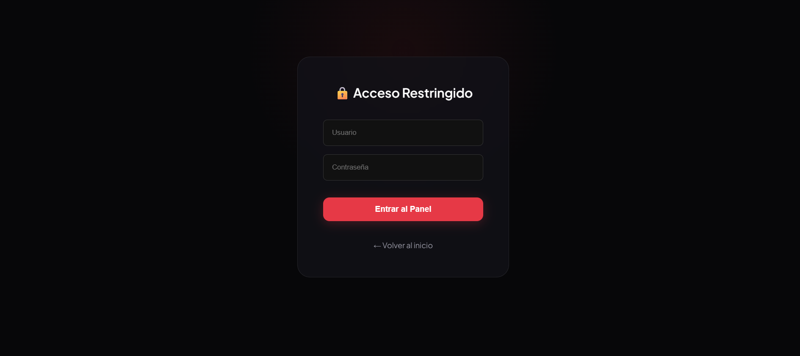

# 🖤 InkFlow

> **El sistema de reservas y drops para tatuadores independientes.**
> *Del primer trazo a tu primer cliente.*

[](https://inkflow-fpcn.onrender.com)

## 🎯 ¿Qué es InkFlow?

InkFlow es una aplicación web diseñada para resolver el caos de gestionar citas por Instagram DMs. Permite a los tatuadores independientes mostrar su galería de diseños (flashes), gestionar reservas con fecha y hora exactas, y administrar todo desde un panel privado y seguro.

## ✨ Características Principales

- 🎨 **Galería de Flash**: Subida de imágenes a la nube (Cloudinary) para mostrar los diseños a los clientes.
- 📅 **Sistema de Reservas**: Los clientes eligen el día y la hora exacta para su cita.
- 🔒 **Panel de Administrador**: Vista privada protegida con contraseña para gestionar las citas.
- 🔍 **Filtro de Citas**: Búsqueda inteligente de reservas por fecha.
- 📱 **Diseño Responsivo**: Experiencia perfecta tanto en computadores como en celulares.
- ✅ **Historial de Citas**: Los tatuajes completados se archivan automáticamente para mantener un registro.

## 🛠️ Stack Tecnológico

- **Backend**: Python, Flask
- **Base de Datos**: SQLite
- **Frontend**: HTML5, CSS3, JavaScript, Jinja2
- **Almacenamiento**: Cloudinary (Imágenes)
- **Despliegue**: Render

## 📸 Capturas de Pantalla

### Página de Inicio y Reservas


### Panel de Administrador (Filtro y Reservas)


## 🚀 Cómo ejecutar este proyecto localmente

1. Clona el repositorio:
   ```bash
   git clone https://github.com/cristianmontenegro-dev/inkflow.git
